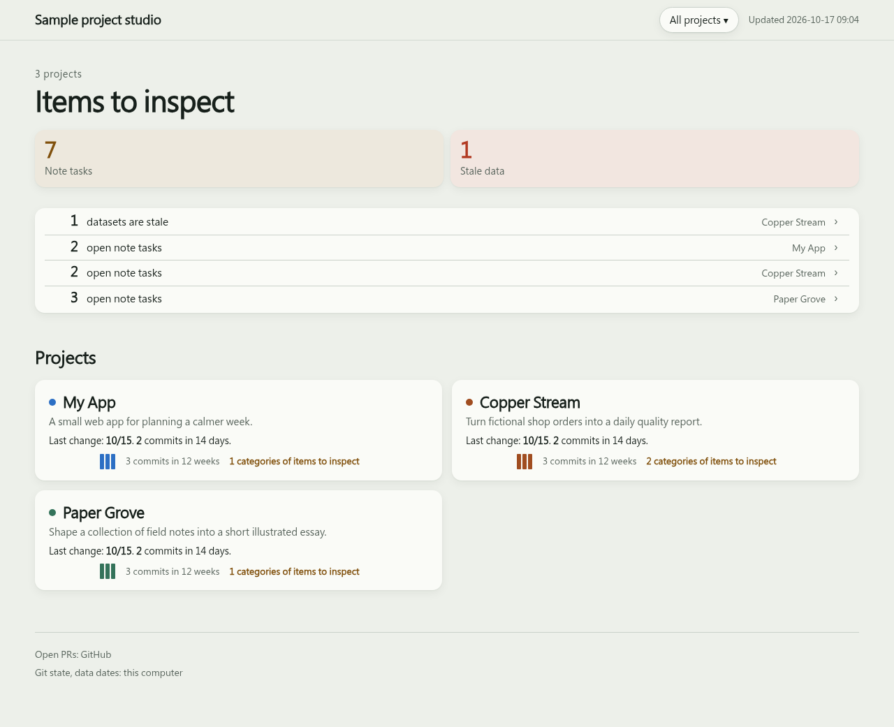

# project-inventory

A Claude Code skill that takes stock of all your projects and builds one dashboard page.


[Mobile screenshot](skills/project-inventory/reference/demo-mobile.png). These are real Chromium
captures of sample-only data, generated by `check_page.py` at 1280 and 390 px; no real project
information is included. Screenshots show the configured example, not an external API run.

### Try it without accounts or services

From this repository checkout (use a new demo directory):

```sh
mkdir -p .tmp
export TMPDIR="$PWD/.tmp"
python3 skills/project-inventory/reference/demo.py .tmp/demo
python3 skills/project-inventory/scripts/collect.py .tmp/demo
python3 skills/project-inventory/scripts/build.py .tmp/demo
python3 skills/project-inventory/scripts/check_page.py .tmp/demo --shots .tmp/demo-shots
```

Open `.tmp/demo/out/index.html`. The helper derives its configuration from
`example-inventory.json`, replaces external sources with a local sample CSV and refuses
to overwrite an existing inventory. Python/git suffice for collect/build; the optional
browser check requires the Playwright/Chromium setup listed below.

For each project the page shows:

- **How it works**: a diagram of the project's steps, each with an icon. Claude drafts it from your code and you confirm it. A step can open to screenshots, formulas or a sketch of its input and output.
- **Tickets** from Linear and/or Notion: done, waiting for your review, open, canceled.
- **Facts**, in two tables. *Local*: checkouts (branch, uncommitted files), data files, Obsidian notes. *Cloud*: each checkout's git remote and unpushed commits, open PRs, the Linear project, the Notion page.
- **Obsidian**: open note tasks (`- [ ]` lines).
- **Data freshness**: the newest date read from inside your data files (not file timestamps).
- **Progress**: commits per week and open/done tickets over the last 90 days (rebuilt where ticket dates are known; unknown periods and incomplete coverage are labelled). Below that, the whole history week by week: each week has a 2–3 sentence plain-words summary, and opens to every commit, finished ticket and new PR. Four weeks show at first; a button loads four more.

The home page lists everything that waits on you, across all projects.

中文說明書：[說明書.md](說明書.md)

## Install

```
/plugin marketplace add YuHsunWang/project-inventory
/plugin install project-inventory@project-inventory
```

After installation, start a new Claude Code session (or reload plugins) and run
`/project-inventory:project-inventory`. The plugin name in
`.claude-plugin/plugin.json` supplies the namespace; `/project-inventory` is the
standalone skill command, not the installed plugin command.
See the [Claude Code plugin loading rules](https://code.claude.com/docs/en/plugins).

### Other AI coding tools (Codex, Hermes, …)

No MCP server needed. From a checkout of this repository, install the skill explicitly:

```sh
# Clean home / first install: clone once, then enter the checkout.
git clone https://github.com/YuHsunWang/project-inventory
cd project-inventory
# Codex (also works if ~/.codex already exists without a skills folder):
mkdir -p ~/.codex/skills/project-inventory
cp -R skills/project-inventory/. ~/.codex/skills/project-inventory/
test -f ~/.codex/skills/project-inventory/SKILL.md && echo "Codex skill files OK"
# Hermes (also works if ~/.hermes already exists without a skills folder):
mkdir -p ~/.hermes/skills/project-inventory
cp -R skills/project-inventory/. ~/.hermes/skills/project-inventory/
test -f ~/.hermes/skills/project-inventory/SKILL.md && echo "Hermes skill files OK"
```

**Existing install:** enter your existing repository checkout and run the matching
`mkdir`, `cp`, and `test` lines above. Other skills remain in their own folders.
**Reinstall:** after updating that checkout, repeat those same lines; files are
updated in place, without creating a nested `project-inventory` folder. Start a
new tool session so it discovers the updated skill.

| Host | Verification / version |
|---|---|
| Claude Code plugin | Expected compatible; no host version verified. Manual loading check pending: reload/new session, then `/project-inventory:project-inventory`. |
| Codex standalone | File installation tested in clean, existing and reinstall homes; no host version verified. Manual loading check pending in a new session. |
| Hermes standalone | Same file installation checks; expected compatible, no host version verified. Manual loading check pending in a new session. |

Any other tool that can run shell commands: tell it to read
`skills/project-inventory/SKILL.md` and follow it. Optional unattended refresh uses
the operating system scheduler through `schedule.py`. Linear and Notion need that tool's own connector (or
`LINEAR_API_KEY` for Linear).

## Use

Say "inventory my projects" or run `/project-inventory:project-inventory` with the plugin
(`/project-inventory` for a standalone skill).

- **First run.** Claude asks which projects to include and where each one lives. It finds data files and asks which ones to watch, then drafts each diagram. For projects with a UI, it finds an existing URL or HTML output, proposes screenshots for the relevant steps, captures them and shows you the images before saving. You can also supply screenshot files. Projects without a UI show no screenshot placeholder. It never starts project servers or runs project/build code. Everything is saved to `~/.project-inventory/inventory.json`.
- **Later runs.** Claude re-reads every source and rebuilds the page. It also writes the summary for any week that has none yet, or got new work since its summary was written (usually just the current week). On the first run that means every past week, so the first run takes longer.

Week summaries are kept in `~/.project-inventory/summaries.json` and are not rewritten once a week is over.

## Requirements

| Needed for | What |
|---|---|
| everything | Python 3.9+, git |
| Linear tickets | a Linear MCP connector in Claude, or `LINEAR_API_KEY` in the environment (faster; scripts then read Linear without Claude) |
| Notion tickets | a Notion MCP connector in Claude |
| GitHub PRs | `gh` CLI logged in, or a GitHub MCP connector |
| parquet / duckdb data checks | `pip install duckdb` |
| UI capture / page check | `pip install playwright && python3 -m playwright install chromium` (optional) |
| Vercel publishing | Vercel CLI logged in (`vercel login`) |

## Where the page goes

You choose. The default is a local file.

| Option | Who can see it |
|---|---|
| Local file `~/.project-inventory/out/index.html` | only you |
| HTML for manual import into claude.ai Artifact | Host-dependent; publication, sharing and access are unverified. |
| Vercel | Vercel-authorized users; access depends on team/project membership, granted access, sharing and bypass settings ([access rules](https://vercel.com/docs/deployment-protection/methods-to-protect-deployments/vercel-authentication)). Protection is switched on before the first deploy, and every deploy is checked from outside. |
| GitHub Pages | **everyone**. Claude asks before the first publish. |

`build.py` also writes `out/artifact.html`: an HTML fragment with styles/scripts and
page content, without the document wrapper or meta tags. It can be offered for manual
import into a compatible host. This repository has no Artifact publishing API, host
capability detection or saved artifact identity; the file path does not preserve a URL.
End-to-end host import/publishing is **pending**. Before claiming support, record the
host/version and test create/update identity, stable URL, external fonts/MathJax scripts,
CSP handling and sharing permissions. No private or fixed-URL guarantee is made.

### GitHub Pages plan and preview

| Repository / plan | Standard Pages path |
|---|---|
| GitHub Free, public repo | Supported; repository and site are public. |
| GitHub Free, private repo | Not supported. Keep the page local or choose another host; never automatically change repo visibility. |
| GitHub Pro / Team, private repo | Supported; the repository stays private but the standard site is public. |

See [GitHub's plan requirements](https://docs.github.com/en/pages/getting-started-with-github-pages/what-is-github-pages).
Enterprise access-controlled Pages is a separate option that this workflow has not verified.
Before publishing, open the local page and review the embedded facts and assets: project
names, tickets, branches, file paths and screenshots may be exposed. For a minimal public
page, use a separate inventory home with only approved project names/tags/diagram text,
empty `sources` and `data`, and omit `notes`, node `paths` and `media`. Collect and build that
home and preview it again; there is no automatic redaction switch. Confirm the account
plan, repository visibility and exact public content before creating a repo or pushing.

## Scripts (usable without Claude)

The scripts are in `skills/project-inventory/scripts/`. To run them by hand, clone this repo
(the plugin install puts its copy in Claude's own plugin folder). Without Claude you write
`~/.project-inventory/inventory.json` yourself: start from
[example-inventory.json](skills/project-inventory/reference/example-inventory.json).

```
S=skills/project-inventory/scripts
python3 $S/collect.py ~/.project-inventory     # git, gh PRs, Obsidian tasks, data checks -> facts/<date>.json
python3 $S/capture_shots.py ~/.project-inventory # existing UI URLs/HTML -> shots/, updates shot paths
python3 $S/build.py   ~/.project-inventory     # -> out/index.html
python3 $S/check_page.py ~/.project-inventory  # headless browser check, every tab and step, 390 + 1280 px
python3 $S/publish_vercel.py ~/.project-inventory <vercel-project-name>
```

Local Git collection fetches `origin` by default, updating refs and `.git/FETCH_HEAD`.
Set `"fetch": false` on a `sources.local[]` entry to keep reading HEAD, branch, dirty files
and history without fetching; ahead/behind and remote unpushed counts then remain unknown.
History defaults to `git log --all`; set `"history": "head"` for commits reachable from HEAD.
The Progress tab labels each checkout's scope. Unread or disconnected Git history is
shown as not collected, with source errors, on project cards and the home list.

Run without Claude, the scripts do not refresh Notion, or Linear unless `LINEAR_API_KEY` is set,
and without an optional text CLI they write no week summaries: new weeks show "no summary yet" until the next Claude run
(`build.py` lists them in `out/summaries-needed.json`).
Use `python3 collect.py HOME --refresh` for one refresh: it builds only that run's snapshot.
Exit 0 means success, 1 means partial collection (the page shows failed sources), and 2 means
fatal failure. `refresh.json` records the run and exact snapshot. Fatal failures retain the
last page's data/time with a visible failure summary; fix the input or permissions and rerun.
Do not publish after exit 2. Standalone build checks this manifest; legacy homes without one
can still be built.

Unattended refresh is opt-in during Setup. Choose `auto_refresh.model` as `none`
(default; no AI calls), `claude` (Haiku), or `codex` (gpt-6-luna). Then, only with
consent, preview and install one OS schedule (cron on macOS/Linux, schtasks on Windows):

```sh
python3 $S/schedule.py print ~/.project-inventory
python3 $S/schedule.py install ~/.project-inventory  # only after reviewing the printed command
python3 $S/schedule.py remove ~/.project-inventory
python3 $S/auto_refresh.py ~/.project-inventory     # run once without installing anything
```

Default: every 2 hours, 08:00–22:00 inclusive, computer local time; customize with
`--every`, `--start`, `--end` or `auto_refresh.schedule` (schema below). Install
replaces this home's marked entry; PATH is captured for git/gh/codex/claude/vercel.
Keep `LINEAR_API_KEY` in the scheduler environment, not the printed command.
Reinstall after moving the skill or changing CLI locations. No chat session is scheduled.

Saved `media.capture` URLs/HTML files are re-captured before checking fingerprints.
Failures print `WARN`, keep the previous image and retry next run; identical images stay untouched.
Same source fingerprints and calendar day skip collect/build/model/publish. Failed
script reads always run and show errors. Data freshness still reads dates inside data.
An enabled text CLI batches missing week summaries and uncached commit/PR notes once
per project; failures leave them missing. The top **Needs Claude** banner lists only
MCP sources needing a read, missing summaries and manual Artifact publishing, with the
exact `/project-inventory` command. Manual and automatic collection share an OS lock;
a crashed process releases it immediately. A live run is never evicted by age.

With a text CLI enabled, commits touching a diagram step's `paths` can also update its
`title`, `sub` and `zone` directly in `inventory.json`. It never adds steps, paths,
details or media; add new steps by hand after reviewing new files (see Setup in SKILL.md).
The first run only records each checkout's HEAD. Later runs send all changed steps of a project in one read-only session,
at most once per calendar day in the inventory timezone. The model may read the project;
repository content is treated as data. Relative paths resolve against each local checkout;
absolute and `~` paths inside it count too, while paths outside all checkouts are ignored.
Invalid steps retain their checked commit for a later day's retry; a valid empty object
means no change is needed. `none` disables step rewriting as well as notes.

Updated boxes show “AI-updated (YYYY-MM-DD)”. Previous text is kept in `step_history.json`;
checked commits and the daily session date live in `state/steps.json`. To undo the latest
rewrite for one step, then rebuild locally:

```sh
python3 $S/auto_refresh.py ~/.project-inventory --revert-step PROJECT_KEY STEP_ID
python3 $S/auto_refresh.py ~/.project-inventory
```

Revert restores only the text and removes the label. It refuses if you edited any step text
after the rewrite; other node settings are preserved. A failed model session also consumes
that day's allowance, without advancing the affected steps' checked commits.

Local HTML is always built on changed runs. Vercel (`publish.to: vercel`, `project`,
optional `team`) deploys only changed page hashes via the existing protected publisher.
GitHub Pages never publishes automatically; Artifact publishing remains manual.

`publish_vercel.py` will not overwrite a Vercel project it did not create. To use one you already
have, pass `--reuse` once.

File formats: [skills/project-inventory/reference/schema.md](skills/project-inventory/reference/schema.md).

## Architecture and support

`inventory.json` + current MCP/API reads → `collect.py` → validated run snapshot +
`refresh.json` → `build.py` → HTML → optional browser check / approved publishing.
Week summaries are written by the assistant, not by Python. Source failures remain visible.

| Path | Current support |
|---|---|
| Local git, CSV/JSON/JSONL/SQLite, notes | Python collection and regression tests; no service connector required. |
| Parquet / DuckDB | Optional DuckDB package; real-source regression coverage. |
| GitHub / Linear | `gh` / API key or current MCP reads; authenticated services required. |
| Notion | Assistant connector contract has offline mock coverage; real workspace acceptance pending. |
| Host skill loading / Artifact publishing | Manual host/version acceptance pending. |
| Page layout | Headless Chromium check at desktop/mobile sizes; optional browser dependency. |

Development and reporting: [CONTRIBUTING.md](CONTRIBUTING.md).
Branch fixes: [CHANGELOG.md](CHANGELOG.md).
Full check: `python3 tests/release_gate.py`; GitHub CI runs the same command on pushes and PRs to main.
License: [MIT](LICENSE).

Captures show their `captured_at` time in the caption. Captions identify the live site or a local build output; capture source URLs stay out of the HTML.

Without `VERCEL_TOKEN`, the publisher runs `vercel whoami` before reading CLI credentials. A failed refresh stops publishing with a login instruction.
