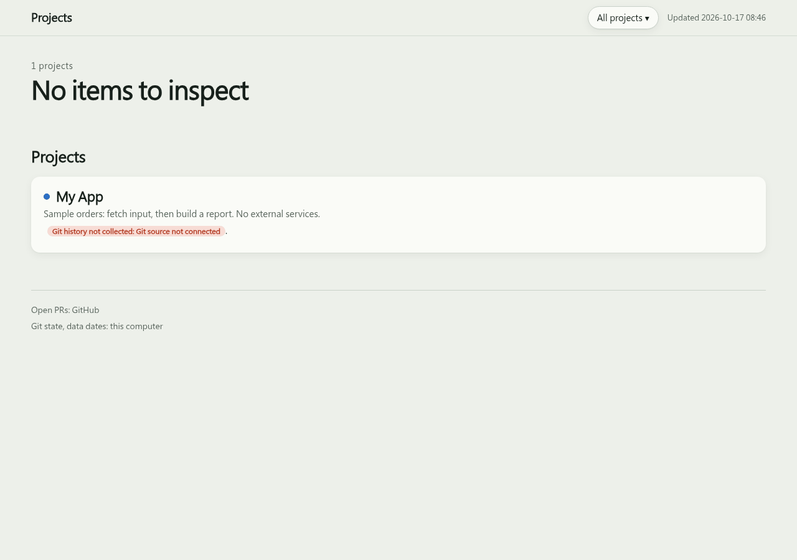

# project-inventory

[English](README.md) | **繁體中文** | [简体中文](README.zh-CN.md)

[](https://github.com/YuHsunWang/project-inventory/actions/workflows/ci.yml) [](https://github.com/YuHsunWang/project-inventory/actions/workflows/pages.yml) [](https://github.com/YuHsunWang/project-inventory/releases/latest) [](LICENSE)

> 給同時照顧多個專案的人：用一頁看懂各專案怎麼運作、最近改了什麼、哪些待辦在等你，以及哪些資料過期了。

這是一份可攜式 [Agent Skill](https://agentskills.io/specification)，可透過 [Skills CLI](https://skills.sh) 用一行指令安裝到多種 agent，也提供原生 Claude Code plugin。



[線上範例 — 僅含虛構資料](https://yuhsunwang.github.io/project-inventory/)

[桌機 PNG](skills/project-inventory/reference/demo-desktop.png) · [手機 PNG](skills/project-inventory/reference/demo-mobile.png)。GIF 與 PNG 只使用範例資料。PNG 是 Chromium 在 1280、390 px 擷取的畫面，不含真實專案資訊或外部 API 執行結果。

繁體中文詳細說明書：[說明書.md](說明書.md)。

## 目錄

- [為什麼用 project-inventory？](#為什麼用-project-inventory)
- [啟動方式](#啟動方式)
- [安裝](#安裝)
- [解除安裝](#解除安裝)
- [使用方式](#使用方式)
- [我的作業流程與搭配 skill](#我的作業流程與搭配-skill)
- [不接服務也能在本機試跑](#不接服務也能在本機試跑)
- [需求](#需求)
- [發布與隱私](#發布與隱私)
- [腳本](#腳本)
- [排程更新與 AI 文字](#排程更新與-ai-文字)
- [驗證狀態](#驗證狀態)
- [常見問題](#常見問題)
- [目錄結構](#目錄結構)
- [授權](#授權)

---

## 為什麼用 project-inventory？

專案資訊分散在程式資料夾、票券、筆記與資料檔裡。這份 skill 把它們整理成一頁，首頁列出所有專案中等你處理的事。

| 來源 | 提供什麼 |
|---|---|
| 本機 Git checkout | 分支、未提交檔案、歷史、遠端與未推送提交 |
| GitHub | 開啟的 PR；只有明確設定的 GitHub Issues 倉庫才會提供票券 |
| Linear／Notion | 待辦：做完、等你確認、還沒做、取消 |
| Obsidian | Markdown 筆記裡未完成的任務（`- [ ]`） |
| CSV／JSON／JSONL／SQLite／Parquet／DuckDB | 讀取檔案內容裡的最新日期，不看檔案時間戳記 |

| 每個專案頁面 | 看到什麼 |
|---|---|
| 運作流程 | 每個步驟都有圖示；根據程式碼畫草稿，由你確認。可展開截圖、公式或輸入／輸出示意。 |
| 待辦 | 做完、等你確認、還沒做、取消的工作 |
| 本機基本資料 | checkout、分支、未提交檔案、資料檔、Obsidian 筆記 |
| 雲端基本資料 | 各 checkout 的遠端與未推送提交、開啟的 PR、Linear 專案、Notion 頁面 |
| 資料新不新鮮 | 每份追蹤資料內的最新日期 |
| 趨勢 | 每週提交次數與近 90 天待辦的未完成／完成趨勢；用已知日期倒推，標示未知期間與不完整的日期涵蓋。 |
| 每週進度 | 從第一筆紀錄起，每週 2–3 句白話說明，可展開看每筆提交、做完的待辦、新開的 PR。先顯示 4 週，每次再載入 4 週。 |

頁尾只列已設定的待辦來源。未設定的專案顯示「未設定待辦來源」。未設定待辦或本機 Git 歷史時，進度頁隱藏空的趨勢區塊；來源讀取失敗仍會顯示。

## 啟動方式

| 工具／安裝方式 | 怎麼啟動 |
|---|---|
| Claude Code plugin | `/project-inventory:project-inventory` |
| 獨立 skill | `/project-inventory` |
| 任何 agent | 直接說「inventory my projects」或「盤點專案」 |
| 其他可執行 shell 指令的工具 | 請工具讀取 `skills/project-inventory/SKILL.md` 並照著執行 |

plugin 命名空間來自 `.claude-plugin/plugin.json`。參考 [Claude Code plugin 載入規則](https://code.claude.com/docs/en/plugins)。

> **Notice:** 安裝「已驗證」表示指令完成，檔案已就位。執行行為只在 Claude Code 與 Codex 驗證過，未記錄宿主版本；儲存庫正式的宿主載入與服務驗收限制仍見[驗證狀態](#驗證狀態)。

> **Tip:** 安裝或替換後，請重載 plugin 或開啟新的工具工作階段。

## 安裝

將這句話貼給你的 agent，即可安裝並自動驗收：

> Install project-inventory: read https://raw.githubusercontent.com/YuHsunWang/project-inventory/main/INSTALL.md and follow it.

### Skills CLI：多種 agent

以下指令預設安裝在使用者範圍：

```sh
# install
npx skills add YuHsunWang/project-inventory -g
npx skills ls -g
# update
npx skills update project-inventory -g
```

2026-10-17 已在隔離的 home 完成安裝檢查：skill 與所有腳本安裝至 `~/.agents/skills/project-inventory`，由 Codex 與其他 universal agent 共用，並以符號連結提供給 Claude Code。`npx skills ls -g` 列出了 Claude Code 與 Codex。

### Claude Code plugin

```sh
# install
claude plugin marketplace add YuHsunWang/project-inventory
claude plugin install project-inventory@project-inventory --scope user
# update
claude plugin marketplace update project-inventory
claude plugin update project-inventory
```

> **Tip:** 工作階段內的 `/plugin install` 會詢問範圍，請選 **User**。重開工作階段或重載 plugin 後，執行 `/project-inventory:project-inventory`。

### 手動複製 Codex 獨立 skill

安裝 skill 不需額外的 MCP server。首次手動安裝時，clone 一次並進入 checkout：

```sh
# install — obtain the checkout once for either manual copy below
git clone https://github.com/YuHsunWang/project-inventory
cd project-inventory
# update — enter your existing, updated checkout and repeat the matching copy below
```

```sh
# install
mkdir -p ~/.codex/skills/project-inventory
cp -R skills/project-inventory/. ~/.codex/skills/project-inventory/
test -f ~/.codex/skills/project-inventory/SKILL.md && echo "Codex skill files OK"
# update — from your updated checkout
mkdir -p ~/.codex/skills/project-inventory
cp -R skills/project-inventory/. ~/.codex/skills/project-inventory/
test -f ~/.codex/skills/project-inventory/SKILL.md && echo "Codex skill files OK"
```

### 手動複製 Hermes 獨立 skill

使用同一份儲存庫 checkout：

```sh
# install
mkdir -p ~/.hermes/skills/project-inventory
cp -R skills/project-inventory/. ~/.hermes/skills/project-inventory/
test -f ~/.hermes/skills/project-inventory/SKILL.md && echo "Hermes skill files OK"
# update — from your updated checkout
mkdir -p ~/.hermes/skills/project-inventory
cp -R skills/project-inventory/. ~/.hermes/skills/project-inventory/
test -f ~/.hermes/skills/project-inventory/SKILL.md && echo "Hermes skill files OK"
```

即使工具的 home 已存在但沒有 `skills` 資料夾，這兩種複製方式也適用。已有安裝或重裝時，在既有 checkout 執行對應的 `mkdir`、`cp`、`test`。檔案會原地更新，保留其他 skill，也不會多包一層 `project-inventory`。完成後開啟新的工具工作階段。Linear、Notion 需接上 agent 自己的連接器；Linear 也能使用 `LINEAR_API_KEY`。

### 專案範圍（替代方式）

若要將 Claude Code plugin 裝在目前專案，而非使用者範圍：

```sh
# install
claude plugin marketplace add YuHsunWang/project-inventory
claude plugin install project-inventory@project-inventory --scope project
# update
claude plugin marketplace update project-inventory
claude plugin update project-inventory
```

## 解除安裝

只執行與安裝方式對應的指令。手動複製的移除指令只刪除該 skill 資料夾。

```sh
# Skills CLI — user scope
npx skills remove project-inventory -g
# Claude Code plugin — user scope
claude plugin uninstall project-inventory@project-inventory --scope user
# Claude Code plugin — project scope alternative
claude plugin uninstall project-inventory@project-inventory --scope project
# Manual Codex copy
rm -r ~/.codex/skills/project-inventory
# Manual Hermes copy
rm -r ~/.hermes/skills/project-inventory
```

## 使用方式

| 執行時機 | 會做什麼 |
|---|---|
| 第一次 | agent 詢問要放哪些專案、各自在哪裡；逐一確認票券來源為 Linear／Notion／GitHub Issues／none 並儲存。PR 倉庫不會自動啟用 Issues。找出資料檔供你挑選，再畫流程草稿讓你確認。 |
| UI 設定 | 尋找既有網址或 HTML 輸出，提議要截圖的步驟，拍完先展示再儲存；也可提供截圖檔。沒有 UI 的專案不顯示截圖佔位。工具不啟動專案伺服器，也不執行專案程式或建置。 |
| 之後每次 | 重新讀取所有來源並重建網頁。補上缺少說明或寫完後又有新工作的週，平常通常只有本週。第一次要涵蓋過去所有週，因此比較久。 |

設定儲存在 `~/.project-inventory/inventory.json`。每週說明放在 `~/.project-inventory/summaries.json`，過完的週不會再改寫。截圖圖說顯示 `captured_at`，並註明來自線上網站或本機建置輸出；HTML 不包含截圖來源網址。

### Git 與待辦來源細節

| 來源 | 收集規則 |
|---|---|
| 本機 Git | 預設 fetch `origin`，更新遠端 refs 與 `.git/FETCH_HEAD`。在個別 `sources.local[]` 設定 `"fetch": false`，仍會讀 HEAD、分支、未提交檔案與歷史，但領先／落後及相對遠端的未推送數量顯示未知。歷史預設 `git log --all`；`"history": "head"` 只讀 HEAD 可到達的提交。進度頁逐一標示 checkout 的範圍。未連接或讀取失敗時，專案卡片與首頁會顯示改動紀錄沒讀到及來源錯誤。 |
| GitHub Issues | 明確設定 `sources.github_issues: ["owner/repo"]`。讀取所有開啟與關閉的 issue，排除 PR，依建立／關閉日期重建趨勢。以不再規劃為由關閉的項目算取消，其餘關閉項目算完成。缺少 `gh` 權限或任一頁未讀取會顯示來源失敗。既有設定仍有效。 |
| Obsidian | 設定時先問哪些資料夾有真正的任務。各來源遞迴掃描 vault `path` 下的 Markdown；選用的 `exclude` 資料夾相對於該路徑。略過 `.obsidian`、`.trash`、程式碼區塊與空白勾選列。同一來源內，完整文字經 `strip()` 後完全相同的任務只算一次，不做模糊比對。任一副本已勾選就算完成，否則算未完成。清單指向含未完成副本的最新檔案，沿用路徑字典序，不解析日期或使用修改時間。計數涵蓋全部去重後的任務，清單只列前 50 個未完成項目。不需新增設定。 |

## 我的作業流程與搭配 skill

1. 跟 agent 設定專案、來源與流程圖。
2. 重新盤點專案資料。
3. 由 agent 根據事實撰寫每週摘要與流程步驟文字。
4. 選擇性地交給指定的寫作 skill 潤稿一次。
5. 用完成的文字建置頁面。
6. 檢查頁面。
7. 發布到你選擇的位置。

我推薦 [sepia](https://github.com/Nanako0129/sepia)，用來去除文章裡像 AI 寫的表達模式。在 Claude Code 安裝：

```sh
claude plugin marketplace add Nanako0129/sepia
claude plugin install sepia@sepia --scope user
```

其他 agent：

```sh
npx skills add Nanako0129/sepia -g
```

啟用方式：回答設定時的選填問題，或在 `inventory.json` 加入：用 Claude Code plugin 安裝時填 `"writing_skill": "sepia:sepia"`（plugin 的 skill 名稱有命名空間），用 Skills CLI 安裝時填 `"writing_skill": "sepia"`。你已安裝的任何改寫或白話文 skill 都能用同樣方式搭配，只要提供安裝名稱。欄位只接受 ASCII 英文字母、數字、`-`、`_`、`:`。省略即不潤稿，也是預設值。agent 不會替你安裝 skill。

> **注意：** 只有對話中的執行會使用寫作 skill。無人值守的排程更新（透過 `claude`／`codex` CLI 執行 `auto_refresh.py`／`step_refresh.py`）不使用。潤稿只改措辭；事實、數字、日期、名稱、連結與 JSON 結構都會核對，必須保持相同，任何一項改變就捨棄這次潤稿。若目前工作階段無法使用該 skill，agent 會在報告中說明一次，繼續完成盤點。

## 不接服務也能在本機試跑

在儲存庫 checkout 中，使用尚未存在的 demo 目錄：

```sh
mkdir -p .tmp
export TMPDIR="$PWD/.tmp"
python3 skills/project-inventory/reference/demo.py .tmp/demo
python3 skills/project-inventory/scripts/collect.py .tmp/demo
python3 skills/project-inventory/scripts/build.py .tmp/demo
python3 tests/demo_fixture.py .tmp/demo --offline-fonts
python3 skills/project-inventory/scripts/check_page.py .tmp/demo --shots .tmp/demo-shots
```

打開 `.tmp/demo/out/index.html`。工具從 `example-inventory.json` 產生設定，建立 3 個虛構專案：網頁應用、資料管線與寫作專案。每個都有本機 Git 歷史、Markdown 待確認任務與範例 CSV，其中一份資料刻意過期。不需帳號、token 或網路；若已有 inventory，工具會拒絕覆寫。collect／build 只需 Python、git；選用的瀏覽器檢查另需下方列出的 Playwright／Chromium。offline-fonts 輔助工具改用備援字型，避免請求字型 CDN。

若要從全新的虛構資料建置重新產生動畫，需 Playwright、Chromium 與 Pillow：

```sh
python3 skills/project-inventory/reference/demo_gif.py
```

## 需求

| 功能 | 需要什麼 |
|---|---|
| 基本功能 | Python 3.9 以上、git |
| Linear 待辦 | Claude 中的 Linear MCP 連接器，或環境變數 `LINEAR_API_KEY`（較快，腳本不需 Claude 就能讀 Linear） |
| Notion 待辦 | Claude 中的 Notion MCP 連接器 |
| GitHub Issues 待辦 | 已登入的 `gh` CLI；明確確認的 `sources.github_issues` 倉庫 |
| GitHub PR | 已登入的 `gh` CLI，或 GitHub MCP 連接器 |
| Parquet／DuckDB 資料檢查 | `pip install duckdb` |
| UI 截圖／頁面檢查 | `pip install playwright && python3 -m playwright install chromium`（選用） |
| Vercel 發布 | 已登入的 Vercel CLI（`vercel login`） |

## 發布與隱私

網頁放哪裡由你選，預設是本機檔案。

| 選項 | 誰看得到 |
|---|---|
| 本機檔案 `~/.project-inventory/out/index.html` | 只有你 |
| 手動匯入 claude.ai Artifact 的 HTML | 依宿主而定；發布、分享與存取權限未驗證 |
| Vercel | Vercel 授權使用者；實際範圍依團隊／專案成員資格、授權、分享與 bypass 設定（[存取規則](https://vercel.com/docs/deployment-protection/methods-to-protect-deployments/vercel-authentication)）。第一次部署前先啟用保護，每次部署後都從外部檢查。 |
| GitHub Pages | **所有人**。首次發布前 agent 會先詢問。 |

`build.py` 也會產出 `out/artifact.html`：保留樣式、腳本與頁面內容，移除文件外框與 meta tags 的 HTML fragment，供相容宿主手動匯入。沒有 Artifact 發布 API、宿主能力偵測或 artifact identity 保存；同一檔案路徑不保證同一網址。端到端匯入／發布驗收仍**待完成**。宣稱支援前，須記錄宿主與版本，測試建立／更新 identity、固定網址、外部字型／MathJax 腳本、CSP 處理與分享權限。目前不保證私人存取或固定網址。

### GitHub Pages 方案與預覽

| 儲存庫／方案 | 標準 Pages 路徑 |
|---|---|
| GitHub Free、公開儲存庫 | 支援；儲存庫與網站都公開 |
| GitHub Free、私人儲存庫 | 不支援。保留本機頁面或換宿主，不能自動變更儲存庫可見性。 |
| GitHub Pro／Team、私人儲存庫 | 支援；儲存庫保持私人，但標準網站公開 |

參考 [GitHub 方案限制](https://docs.github.com/en/pages/getting-started-with-github-pages/what-is-github-pages)。Enterprise 的存取受限 Pages 是另一種選項，此流程尚未驗證。

> **Notice:** 發布前先預覽本機網頁與內嵌圖片等資產。專案名稱、待辦、分支、檔案路徑與截圖可能公開。建立儲存庫或推送前，先確認帳號方案、儲存庫可見性與確切公開內容。

若要公開最少欄位，另建 inventory home，只保留同意公開的專案名稱／標籤／流程文字，讓 `sources` 與 `data` 留空，省略 `notes`、node 的 `paths` 與 `media`。對該 home 重新 collect、build、預覽。目前沒有自動遮蔽開關。

`publish_vercel.py` 不會覆蓋它未建立的 Vercel project；若確定要使用既有 project，加上 `--reuse` 執行一次。未設定 `VERCEL_TOKEN` 時，會先跑 `vercel whoami`，再讀 CLI 憑證。憑證更新失敗會停止發布並提示登入。

## 腳本

腳本位於 `skills/project-inventory/scripts/`，不靠 Claude 也能執行。手動使用時先 clone 儲存庫；plugin 的副本放在 Claude 自己的 plugin 資料夾。以 [example-inventory.json](skills/project-inventory/reference/example-inventory.json) 為起點，自行撰寫 `~/.project-inventory/inventory.json`。

```sh
S=skills/project-inventory/scripts
python3 $S/collect.py ~/.project-inventory     # git, gh PRs/opted-in Issues, Obsidian tasks, data checks -> facts/<date>.json
python3 $S/capture_shots.py ~/.project-inventory # existing UI URLs/HTML -> shots/, updates shot paths
python3 $S/build.py   ~/.project-inventory     # -> out/index.html
python3 $S/check_page.py ~/.project-inventory  # headless browser check, every tab and step, 390 + 1280 px
python3 $S/publish_vercel.py ~/.project-inventory <vercel-project-name>
```

不靠 Claude 執行時，腳本不會更新 Notion；Linear 則需設定 `LINEAR_API_KEY`。未啟用選用的文字 CLI 時，也不會產生週摘要，新的一週會顯示「還沒有說明」，直到下次 Claude 執行。`build.py` 將待補項目列在 `out/summaries-needed.json`。

用 `python3 collect.py HOME --refresh` 執行一次更新，只建置該次執行的 snapshot。

| 結束碼 | 意義／處理方式 |
|---|---|
| 0 | 成功 |
| 1 | 部分收集成功；頁面顯示失敗的來源 |
| 2 | 嚴重失敗；修正輸入或權限後重跑，不可發布。 |

`refresh.json` 記錄本次執行與確切 snapshot。嚴重失敗會保留上一版頁面的資料與時間，並顯示失敗摘要。獨立 build 會檢查此 manifest；沒有 manifest 的舊 home 仍可建置。檔案格式見 [schema.md](skills/project-inventory/reference/schema.md)。

## 排程更新與 AI 文字

Setup 時可選擇啟用無人值守更新。`auto_refresh.model` 可選 `none`（預設，不呼叫 AI）、`claude`（Haiku）或 `codex`（gpt-6-luna）。取得同意後才預覽並安裝一筆作業系統排程：macOS／Linux 用 cron，Windows 用 schtasks。

以下指令使用[腳本](#腳本)一節設定的 `S`。

```sh
python3 $S/schedule.py print ~/.project-inventory
python3 $S/schedule.py install ~/.project-inventory  # only after reviewing the printed command
python3 $S/schedule.py remove ~/.project-inventory
python3 $S/auto_refresh.py ~/.project-inventory     # run once without installing anything
```

| 行為 | 細節 |
|---|---|
| 排程 | 電腦當地時間 08:00–22:00，每 2 小時一次，含起訖時間。可用 `--every`、`--start`、`--end` 或 schema 的 `auto_refresh.schedule` 調整。安裝只替換此 home 的標記項目，並保存供 git／gh／codex／claude／vercel 使用的 PATH。`LINEAR_API_KEY` 要放在排程環境，不寫入印出的命令。移動 skill 或 CLI 後要重裝排程。不會排程聊天工作階段。 |
| 截圖 | 檢查指紋前，重新擷取已儲存的 `media.capture` 網址／HTML。失敗印出 `WARN`，保留舊圖，下次重試；相同圖片不動。 |
| 變更與鎖 | 來源指紋與日期都相同，就跳過 collect／build／模型／發布。腳本讀取失敗一定重跑並顯示錯誤；新鮮度仍讀資料內日期。手動與自動收集共用作業系統鎖，程序中斷立即釋放；執行中的工作不會因時間過久被移除。 |
| AI 摘要與說明 | 啟用文字 CLI 後，每個專案批次補一次缺少的週摘要與尚未快取的 commit／PR 說明；失敗則保留待補項目。 |
| 需要 Claude 協助 | 頁首只列需重讀的 MCP 來源、缺少的週摘要與 Artifact 手動發布，每項都附上完整 `/project-inventory` 指令。 |
| 發布 | 有變更時一定先建置本機 HTML。Vercel（`publish.to: vercel`、`project`、選用 `team`）只在頁面雜湊改變時，透過受保護的發布程式部署。GitHub Pages 不會自動發布；Artifact 仍須手動發布。 |

### 流程文字更新與還原

啟用文字 CLI 後，提交若碰到步驟的 `paths`，可直接更新 `inventory.json` 裡的 `title`、`sub`、`zone`。不會新增步驟、路徑、詳細說明或媒體；新步驟需先檢視新檔案，再手動加入（見 [SKILL.md](skills/project-inventory/SKILL.md) 的 Setup）。`none` 會同時關閉步驟改寫與說明。

第一次只記錄各 checkout 的 HEAD。之後同一專案所有變動步驟共用一次唯讀工作階段，依 inventory 時區，每個日曆日最多一次。模型可以讀取專案，儲存庫內容一律視為資料。相對路徑從各 checkout 解析；位於其中的絕對路徑與 `~` 路徑也算，所有 checkout 外的路徑則忽略。不合規的步驟回覆會保留先前檢查提交，留待後續日期重試；有效的空物件表示無須變更。

改過的方框顯示「AI 自動更新（YYYY-MM-DD）」。舊文字放在 `step_history.json`，檢查過的提交與每日工作階段日期放在 `state/steps.json`。還原單一步驟最近一次改寫並重建本機頁面：

```sh
python3 $S/auto_refresh.py ~/.project-inventory --revert-step PROJECT_KEY STEP_ID
python3 $S/auto_refresh.py ~/.project-inventory
```

還原只恢復文字並移除標籤，保留其他 node 設定。如果改寫後曾手動編輯任何步驟文字，就會拒絕還原。模型工作階段失敗也占用當天額度，但不推進受影響步驟的檢查提交。

## 驗證狀態

`inventory.json` 加上本次 MCP／API 讀取 → `collect.py` → 驗證過的執行 snapshot 與 `refresh.json` → `build.py` → HTML → 選用瀏覽器檢查／經同意的發布。每週說明由 AI 助理撰寫，Python 不會自行產生；來源失敗仍會顯示。

下表將正式宿主載入驗收與前述安裝、執行檢查分開記錄。特定宿主版本的驗收仍待完成。

| 宿主 | 驗證範圍／版本 |
|---|---|
| Claude Code plugin | 預期相容；未驗證宿主版本。待人工重載／重開工作階段，再執行 `/project-inventory:project-inventory` 驗收載入。 |
| Codex 獨立 skill | 已測乾淨 home、既有安裝與重裝的檔案結構；未驗證宿主版本。新工作階段的實際載入待人工驗收。 |
| Hermes 獨立 skill | 同樣測過檔案安裝；預期相容，未驗證宿主版本。新工作階段的實際載入待人工驗收。 |

| 路徑 | 目前支援範圍 |
|---|---|
| 本機 Git、CSV／JSON／JSONL／SQLite、筆記 | Python 收集與回歸測試，不需服務連接器 |
| Parquet／DuckDB | 選用 DuckDB 套件；有真實來源回歸驗證 |
| GitHub／Linear | `gh`／API key 或本次 MCP 讀取；需登入來源服務 |
| Notion | 助理連接器流程有離線 mock 測試；真實 workspace 驗收待完成 |
| 宿主 skill 載入／Artifact 發布 | 宿主與版本的人工驗收待完成 |
| 頁面排版 | Headless Chromium 檢查桌機／手機尺寸；瀏覽器套件可選 |

完整檢查：`python3 tests/release_gate.py`。GitHub CI 在推送／PR 到 main 時執行相同指令。[觸發評估](evals/README.md) 需要 Claude 憑證；離線檢查只驗證測例設定，不代表實際觸發率。測例衡量 skill 是否被呼叫，不評估頁面品質或設定行為。

開發與回報：[CONTRIBUTING.md](CONTRIBUTING.md)。修正紀錄：[CHANGELOG.md](CHANGELOG.md)。

## 常見問題

| 狀況 | 檢查方式 |
|---|---|
| 找不到 plugin 指令 | 重載 plugin 或開新工作階段；plugin 用 `/project-inventory:project-inventory`，獨立 skill 用 `/project-inventory`。 |
| 腳本沒有更新 Notion、Linear 或週摘要 | Notion 需助理連接器；Linear 需連接器或 `LINEAR_API_KEY`；摘要需啟用文字 CLI 或等下次 Claude 執行。 |
| 來源失敗／更新結束碼為 1 或 2 | 讀取頁面上的來源錯誤與 `refresh.json`，修正輸入／權限後重跑。結束碼為 2 時不可發布。 |
| 趨勢圖空白 | 設定待辦來源及／或本機 Git 歷史；未知或不完整的待辦日期會另行標示。 |
| Vercel 拒絕使用既有 project | 只有確定要使用該 project 時，才加 `--reuse` 執行一次。 |
| Vercel 憑證更新失敗 | 依提示登入；未設定 `VERCEL_TOKEN` 時，發布前 `vercel whoami` 必須成功。 |
| 截圖失敗 | 印出 `WARN` 並保留舊圖，下次再試；不會啟動專案伺服器或建置。 |
| 流程步驟拒絕還原 | AI 改寫後文字曾被編輯，保護機制會保留你的修改。 |

## 目錄結構

```text
project-inventory/
├── .claude-plugin/
│   ├── plugin.json                 # plugin identity and version
│   └── marketplace.json            # Claude Code marketplace entry
├── .github/workflows/
│   ├── ci.yml                      # offline release gate
│   └── pages.yml                   # sample-only Pages demo
├── skills/project-inventory/
│   ├── SKILL.md                    # setup and refresh instructions
│   ├── scripts/                    # collect, build, capture, schedule, publish
│   └── reference/                  # schema, example config, demo and screenshots
├── evals/                          # trigger cases and instructions
├── tests/                          # regressions and release gate
├── README.md                       # English
├── README.zh-TW.md                  # Traditional Chinese
├── README.zh-CN.md                  # Simplified Chinese
├── 說明書.md                         # detailed Traditional Chinese manual
├── CONTRIBUTING.md
├── CHANGELOG.md
└── LICENSE
```

所有盤點狀態預設放在 `~/.project-inventory`：`inventory.json` 是設定、`gathered/<date>.json` 是 MCP 讀取、`facts/<date>.json` 是 snapshot、`summaries.json` 是週摘要、`shots/` 是截圖、`out/` 是產生的頁面。

## 授權

[MIT](LICENSE)。
